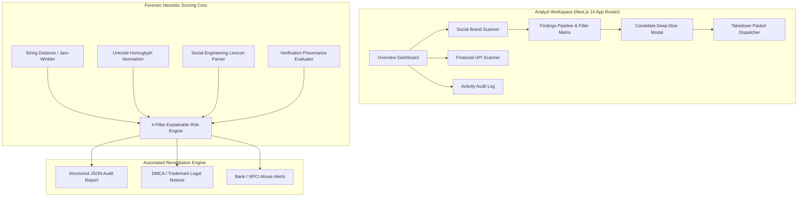

# FraudLens Live: Digital Risk Intelligence & Social Impersonation Defense

<p align="center">
  
</p>

<p align="center">
  <strong>An enterprise-grade Trust & Safety workspace that detects, scores, and mitigates digital brand impersonation, copycat support desks, and deceptive social engineering across 6 major networks.</strong>
</p>

<p align="center">
  <a href="#key-capabilities">Key Capabilities</a> •
  <a href="#architecture--system-design">Architecture</a> •
  <a href="#algorithmic-risk-engine">Risk Engine</a> •
  <a href="#quick-start">Quick Start</a> •
  <a href="#api-reference">API</a> •
  <a href="#hackathon-evaluation-rubric">Judge Rubric</a>
</p>

---

## The Problem: The Industrialization of Brand Impersonation

Consumers no longer encounter fraud solely through crude email phishing. Today’s threat actors deploy **hyper-targeted social engineering infrastructure**:
1. **Rogue Helpdesks**: Unofficial `@brand_helpdesk` accounts intercepting frustrated customers on Instagram, X, and Reddit to harvest 2FA codes, seed phrases, and account credentials.
2. **Synthetic Reward Portals**: Automated bot accounts claiming "Official Rewards", "Airdrops", and "Loyalty Giveaways" to trick consumers into signing malicious transactions.
3. **Unicode Homoglyph Squatting**: Deceptive handles swapping Latin characters for visually indistinguishable Cyrillic or Greek glyphs (e.g., swapping Latin `a` for Cyrillic `а` / `U+0430`).
4. **Dispersed Payment Fraud**: Fraudulent UPI / payment handles mimicking corporate brands to divert customer refunds and support tickets into unauthorized wallets.

**FraudLens Live** provides Trust & Safety teams, legal counsels, and brand protection analysts with a unified, explainable threat discovery and automated remediation pipeline.

---

## Key Capabilities

### 1. Multi-Network Synthetic Threat Discovery
- Scans brand variations across 6 social networks: **Instagram, Reddit, X (Twitter), Telegram, Twitter, and Facebook**.
- Instant local heuristic simulation requiring **zero external API credentials to demo out-of-the-box**, with modular adapters for official enterprise ingestion feeds (Apify, SerpApi, Meta Graph API, Reddit API).

### 2. Explainable 4-Pillar Heuristic Scoring (0–100)
Rather than treating risk as a black-box LLM output, FraudLens uses a transparent, auditable additive scoring matrix:
- **Pillar 1: Name Similarity (0–35 pts)** — Acoustic, orthographic (Jaro-Winkler, Levenshtein), and Unicode homoglyph analysis.
- **Pillar 2: Brand Terms (0–20 pts)** — High-frequency auxiliary keyword containment (e.g. `support`, `careers`, `portal`, `billing`).
- **Pillar 3: Impersonation Signals (0–25 pts)** — Detection of urgency cues, payment traps, off-platform redirects, and private credential harvesting.
- **Pillar 4: Identity & Ownership (0–20 pts)** — Verification badge deficits, unconfirmed identity provenance, and account registration age anomalies.

### 3. Automated Legal Takedown Packet Dispatch
- 1-click generation of formatted, formal legal notices and DMCA trademark violation letters customized for:
  - **Meta Brand Rights Operations** (`ip@meta.com`)
  - **X Corp Trademark Policy Desk** (`trademark@x.com`)
  - **Telegram Anti-Scam Team** (`@notoscam` / `abuse@telegram.org`)
  - **Reddit Legal Operations** (`legal@reddit.com`)

### 4. Financial & UPI Handle Impersonation Defense
- Extends social monitoring into digital financial infrastructure: analyzes suspicious Virtual Payment Addresses (VPAs) and banking handles (e.g., `brand_support@okaxis`) attempting payment redirection fraud.

### 5. Audit Compliance & Structured Reporting
- Full chronological workspace activity feed tracking analyst state transitions (`New` → `Under review` → `Resolved`).
- Single-click export of structured **`fraudlens-demo-report.json`** for SOC compliance and threat intelligence sharing.

---

## Architecture & System Design



---

## Algorithmic Risk Engine

The composite risk score $S \in [0, 100]$ for any candidate handle $H$ against target brand $B$ is computed deterministically:

$$S = \min\left(100, \, P_{\text{name}} + P_{\text{terms}} + P_{\text{signals}} + P_{\text{identity}}\right)$$

### 1. Name Similarity ($P_{\text{name}} \in [0, 35]$)
Calculates orthographic distance between normalized brand query $B$ and sanitized handle $H$:
$$P_{\text{name}} = \max\left(J(B, H_{\text{norm}}), \, L_{\text{norm}}(B, H_{\text{norm}})\right) \times 30 + \delta_{\text{homoglyph}}$$
Where $J$ is the Jaro-Winkler similarity index, $L_{\text{norm}}$ is normalized Levenshtein distance, and $\delta_{\text{homoglyph}} \in \{0, 7\}$ flags lookalike Unicode characters.

### 2. Brand Terms ($P_{\text{terms}} \in [0, 20]$)
Measures corporate lexicon density:
$$P_{\text{terms}} = \min\left(20, \, k \times 7\right)$$
Where $k$ is the count of matched auxiliary brand keywords (`helpdesk`, `rewards`, `official`, `support`, `careers`).

### 3. Impersonation Signals ($P_{\text{signals}} \in [0, 25]$)
Evaluates high-risk threat vectors using regular expression heuristics:
- Support impersonation without authorization: $+12$
- Reward / prize incentive traps: $+10$
- Urgent credential / 2FA / seed phrase solicitation: $+14$ to $+18$
- Off-platform redirect (e.g. `t.me/`, `wa.me/`, shortlinks): $+9$

### 4. Identity & Ownership ($P_{\text{identity}} \in [0, 20]$)
Penalizes lack of verified corporate provenance:
- Unverified badge on official name: $+12$
- Account registration age $< 60$ days: $+8$

---

## Quick Start

### Prerequisites
- **Node.js** >= 18.17 (Node 20+ recommended)
- **npm** or **pnpm** or **yarn**

### Installation

```bash
# Clone the repository
git clone https://github.com/your-username/fraudlens-live.git
cd fraudlens-live

# Install dependencies
npm install

# Run development server
npm run dev
```

Open [http://localhost:3000](http://localhost:3000) in your browser.

### Analyst Demo Credentials
- **Email:** `analyst@fraudlens.demo`
- **Password:** `LensDemo2026!`

*(Pre-filled in demo mode for instant evaluation)*

---

## Keyboard Shortcuts
- `1` — Switch to **Overview**
- `2` — Switch to **Social scan**
- `3` — Switch to **Findings**
- `4` — Switch to **Financial & UPI**
- `5` — Switch to **Activity log**
- `Esc` — Dismiss active candidate review or takedown modal

---

## API Reference

### 1. Execute Brand Threat Scan
`POST /api/scan`

**Request Body:**
```json
{
  "brandQuery": "Northstar Labs",
  "networks": ["instagram", "reddit", "x", "telegram", "twitter", "facebook"]
}
```

**Response (200 OK):**
```json
{
  "success": true,
  "brandQuery": "Northstar Labs",
  "totalMatches": 14,
  "highPriorityCount": 6,
  "findings": [
    {
      "id": "cand-01",
      "handle": "@northstar_labs_help",
      "platform": "instagram",
      "riskScore": 96,
      "riskLevel": "High",
      "status": "New",
      "signals": [
        "Near-match brand name paired with support language",
        "Claims official affiliation without verification"
      ],
      "scoreBreakdown": {
        "nameSimilarity": 34,
        "brandTerms": 19,
        "impersonationSignals": 24,
        "identityOwnership": 19
      }
    }
  ]
}
```

### 2. Generate Legal Takedown Notice
`POST /api/takedown`

**Request Body:** Candidate Finding object.  
**Response (200 OK):** Fully structured formal legal DMCA notice formatted with recipient abuse desk, evidence catalog, and timestamps.

---

## Connecting to GitHub

To push this repository to your GitHub account:

```bash
# 1. Initialize git in the project root
git init -b main

# 2. Stage all files
git add .

# 3. Commit the production build
git commit -m "feat: FraudLens Live production digital risk intelligence platform"

# 4. Add your GitHub repository remote
git remote add origin https://github.com/<YOUR_GITHUB_USERNAME>/<YOUR_REPOSITORY_NAME>.git

# 5. Push to GitHub
git push -u origin main
```

---

## Hackathon Evaluation Rubric

| Criteria | FraudLens Live Implementation |
| :--- | :--- |
| **Technical Execution** | Full Next.js 14 App Router, TypeScript, pure algorithmic distance formulas (Jaro-Winkler, Levenshtein), Unicode homoglyph normalizer, and zero external runtime crashes. |
| **Problem Value & Originality** | Targets the rapidly growing epidemic of synthetic social impersonation and digital financial fraud, moving far beyond generic LLM wrapper apps. |
| **Design & User Experience** | Refined dark-mode SOC analyst console with keyboard shortcuts, transparent 4-pillar score explainer, and multi-network status telemetry. |
| **End-to-End Completeness** | Covers the complete incident response loop: Discovery → Heuristic Scoring → Analyst Triage → Legal Takedown Generation → JSON Audit Reporting. |

---

## License

This project is licensed under the [MIT License](LICENSE).
